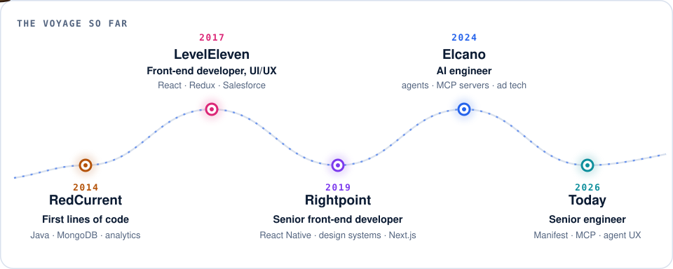

  <picture>
    <source media="(prefers-color-scheme: dark)" srcset="assets/header-dark.svg" />
    
  </picture>

  
  
  

  <picture>
    <source media="(prefers-color-scheme: dark)" srcset="assets/terminal-dark.svg" />
    
  </picture>

## ✨ About me

<picture>
  <source media="(prefers-color-scheme: dark)" srcset="assets/about-dark.svg" />
  
</picture>

## 📈 2026 in numbers

<picture>
  <source media="(prefers-color-scheme: dark)" srcset="assets/stats-dark.svg" />
  
</picture>

Counted from git history across public and private repositories, including a retired one that GitHub no longer shows on my graph.

## 🧭 What I'm building

<picture>
  <source media="(prefers-color-scheme: dark)" srcset="assets/pipeline-dark.svg" />
  
</picture>

- ⚓ **Manifest, an AI deal platform I designed and built end to end.** Traders describe a deal in plain English; an agent plans it, a person approves it, and it goes live on every SSP the brief names, then gets edited, paused or cloned the same way. It runs on MCP servers I built for 9 SSPs.
- 🔍 **Audit engines.** Deep audits compare what was asked for with what is actually live, and catch drift before anyone else does.
- 🪪 **Human-in-the-loop UX in Fleet.** Readable approval cards, one card per turn, live progress while a call runs, retry on failure, and the agent picking up where it left off once you approve.
- 🧩 **Self-serve tools.** Internal tools the whole team can edit, and capability docs generated from code so they can't drift from what the system does.
- 🔎 **LLM classification in Lens.** Websites, apps and CTV channels sorted into quality tiers, with a cross-provider model fallback chain that retries instead of guessing.
- 🎨 **Flag.** The company design system I created: tokens, themes, icons and components behind every Elcano product.

## 🛠️ Selected work

<table>
  <tr>
    <td width="50%" valign="top">
      <h3>⚓ Manifest</h3>
      
<code>creator</code> · <code>architect &amp; engineer</code> · private

      
<b>An AI deal platform for programmatic advertising.</b> I designed and built it end to end, starting in April 2026, with <b>1,100+ commits</b> so far. It takes a deal from a plain-English brief all the way to live: audit → agent plan → human approval → booking → read-back verification → deal sheets. It also has a chat that can book and edit deals, and deep audits that catch drift.

      
Underneath are the MCP servers I built for <b>9 SSPs</b>, with full create and update on each.

    </td>
    <td width="50%" valign="top">
      <h3>🎨 <a href="https://github.com/ElcanoTek/flag">Flag</a></h3>
      
<code>creator</code> · open source · <a href="https://flag.elcanotek.com/">live preview ↗</a>

      
The company design system: tokens in CSS and JSON kept in sync by CI, WCAG AA contrast checked in both themes, a light/dark theme contract, icons, component specs and an email-safe report template.

    </td>
  </tr>
  <tr>
    <td valign="top">Go · React · TypeScript · Python · MCP</td>
    <td valign="top">CSS · design tokens · accessibility · theming</td>
  </tr>
  <tr>
    <td width="50%" valign="top">
      <h3>🤖 <a href="https://github.com/ElcanoTek/fleet">Fleet</a></h3>
      
<code>contributor</code> · open source

      
A general-purpose agent fleet you run yourself: any model, in a sandbox, on a budget. I built its <b>approval experience</b>, the part that keeps a person in charge when an agent wants to do something that matters.

    </td>
    <td width="50%" valign="top">
      <h3>🔎 <a href="https://github.com/ElcanoTek/lens">Lens</a></h3>
      
<code>co-builder</code> · open source

      
Classifies websites, apps and CTV channels into quality tiers with IAB content categories. Sites climb an escalating crawl ladder only as far as they need to, then an LLM decides. I built the <b>multi-provider model fallback chain</b>, hardened response parsing so a cut-off answer is retried instead of guessed, spreadsheet uploads, and the move onto the design system.

    </td>
  </tr>
  <tr>
    <td valign="top">Go · TypeScript · MCP · agent UX</td>
    <td valign="top">Python · LLMs · OpenRouter · Firecrawl · web crawling</td>
  </tr>
</table>

## 🧰 Toolbox

<picture>
  <source media="(prefers-color-scheme: dark)" srcset="assets/stack-dark.svg" />
  
</picture>

## ⛵ The voyage

<picture>
  <source media="(prefers-color-scheme: dark)" srcset="assets/voyage-dark.svg" />
  
</picture>

## 💼 Experience

<picture>
  <source media="(prefers-color-scheme: dark)" srcset="assets/experience-dark.svg" />
  
</picture>

## 🌿 Off the clock

<picture>
  <source media="(prefers-color-scheme: dark)" srcset="assets/hobbies-dark.svg" />
  
</picture>

  <b>Let's build something beautiful, effortless and trustworthy.</b>

  
  

  

